# Blue/red linear (BRtest) findings

Living summary. Update the "Current results" section and add a line to the
log each time new participants are added. Plan and checklist:
`PLANblueredLinear.md`. Design: `docs/superpowers/specs/2026-11-12-blueredlinear-brtest-design.md`.
Notebook: `blueredLinear/notebooks/04_brtest_fm100.ipynb` (re-run all cells
after adding data). Running it also regenerates the figures below
(`docs/figures/brlinear_*.png`).

## Experiment

- Blue (0-1700 DAC, 11 steps of 170) flickers at 10 Hz against fixed red
  (1800 DAC). 3 s stimulus, 750 ms gap.
- Blue grid change: from MET056 on, 14 steps of 170 over 0-2210. The first 11
  are the old grid; the upper register is extended. All cross-session
  analyses use the common 0-1700 grid.
- **MET055 session 2 setup error:** 14 steps linearly spaced over 0-1700
  (~131 apart; the upper limit was not raised to 2210). Only 0 and 1700 fall
  on the common grid. This session is plotted at its true blue levels and left
  out of every step-aligned and window analysis (see its section below).
- Runs per session, in order: red baseline NF (8 trials, red vs blue 0),
  BR NF rep 1, BR NF rep 2, red baseline YF, BR YF rep 1, BR YF rep 2. Each
  BR run starts with 2 non-flickering red trials.
- YF = yellow filter that blocks blue, minimally affects red.
- Blue 1360 is the measured luminance match to red 1800.
- Two sessions about one week apart (file suffix `b` = session 2).
- Each value is an FBCCA score on a 3 s epoch (not an amplitude): chance
  level is ~0.6-0.8 (non-flicker trials), and the scale saturates.

Hypotheses:
1. Intact blue vision -> NF and YF curves differ; blue deficit -> they
   converge. Should follow the FM100 blue-yellow score (PES_BY, higher = worse).
2. NF curve has its minimum near 1360 (luminance match).

## Methods

- `norm` = score / baseline, baseline = median of the same participant x
  session x filter's 8-trial base run (NF by `base_NF`, YF by `base_YF`).
  1 = as strong as red vs nothing. Mean instead of median changes per-condition
  baselines by < 0.08 and correlations by <= ~0.15.
- The two reps are averaged per step.
- Windows on the blue axis: `mean` = all 11 steps, `low` = 0, 170, 340,
  `high` = 1360, 1530, 1700.
- Correlations: Spearman, over sessions and over participants (sessions
  averaged first). Bootstrap CIs resample participants. ICC(A,1): two-way
  random, absolute agreement, single measurement.
- MET052 session 1 `BR_YF_2` has 10 steps (which one is missing is unknown);
  only rep 1 is used for that condition.

## Current results

Data as of 2026-11-25: 8 participants (MET050-MET057, all CTR, age > 50),
15 sessions, 7 with both sessions. MET055 session 2 is off-grid, so the
analyses below use 14 sessions and 6 two-session pairs (FM100 ICC: 7 pairs).
MET056 (both sessions) and MET057 (14 steps, 0-2210) enter every analysis
through their first 11 steps; their 1870-2210 steps are in the per-session
plots only. PES_BY range 15-106. All p-values
uncorrected; many tests were run. Treat everything as leads.

### Data quality
- The blue = 0 step falls inside its baseline's min-max in 50/59 reps, but
  sits in the lower half of the baseline trials more often than not.
- MET050 barely responds (baseline ~0.73 vs non-flicker ~0.63).
- Rep 1 vs rep 2 agreement per step is weak.

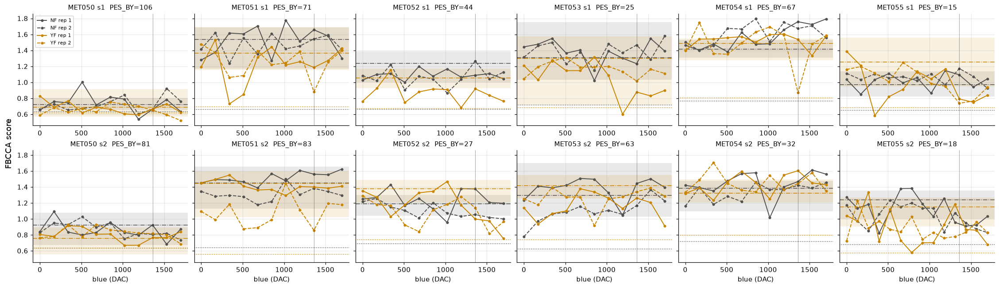
Raw FBCCA score per session (columns = participants, rows = sessions). Gray =
NF, gold = YF; solid = rep 1, dashed = rep 2. Shaded band = min-max of the
8 baseline trials, dash-dot = baseline median, dotted = non-flicker floor.

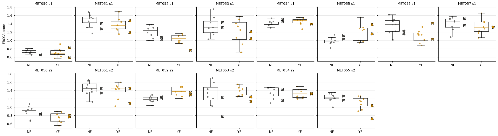
Anchor check. Box + dots = the 8 baseline trials; X = the blue = 0 step of
each rep (same stimulus).

### M1. NF vs YF against FM100 blue-yellow
- NF sits above YF at almost every step.
- The YF curve carried most of the FM100 relation (better blue-yellow ->
  YF drops further below its baseline at high blue). With MET056 session 2
  no feature is significant any more; YF high, the one that had held through
  MET056 and MET057, falls to +0.36 (p = 0.21) over sessions.

| Feature vs PES_BY | rho sessions (p), n = 14 | rho participants (p), n = 8 | before MET056b (n = 13 / 8) |
|---|---|---|---|
| YF mean | +0.25 (0.39) | +0.45 (0.26) | +0.45 (0.13) / +0.45 (0.26) |
| YF high | +0.36 (0.21) | +0.31 (0.46) | +0.58 (0.037) / +0.57 (0.14) |
| NF - YF mean | -0.11 (0.71) | -0.38 (0.35) | -0.30 (0.32) / -0.38 (0.35) |
| NF - YF high | -0.15 (0.61) | -0.40 (0.32) | -0.36 (0.23) / -0.40 (0.32) |

- MET056 session 2 (PES_BY 22, still among the best) has the highest YF
  high of all sessions (1.19) and the most negative gap (high -0.39): the
  opposite of what hypothesis 1 predicts for good blue-yellow vision. Part
  of this is a low YF baseline that session (median 0.96 vs 1.14 in
  session 1).
- MET057 (PES_BY 65, mid-range) has a low YF at high blue (0.69), which
  is not what its mid-range PES_BY predicts.
- Dropping MET050: YF high +0.30 (0.34), gap high -0.06.
- Participant-level rhos barely move for the gap (MET056's two sessions
  average to a similar point), but sessions now carry no signal. The
  relation was carried by the 11-step sessions; both 14-step participants
  (MET056, MET057) go against it.

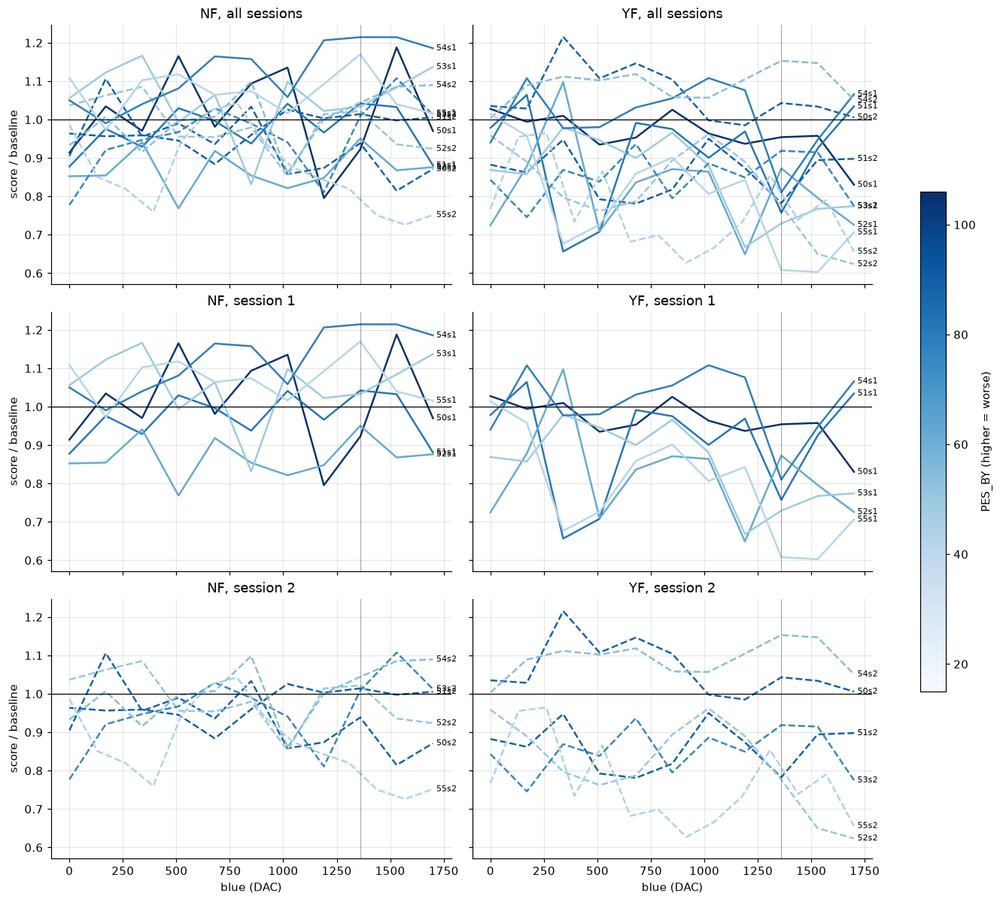
Normalized curves, one line per session, darker = worse PES_BY. Rows: all
sessions, session 1, session 2.

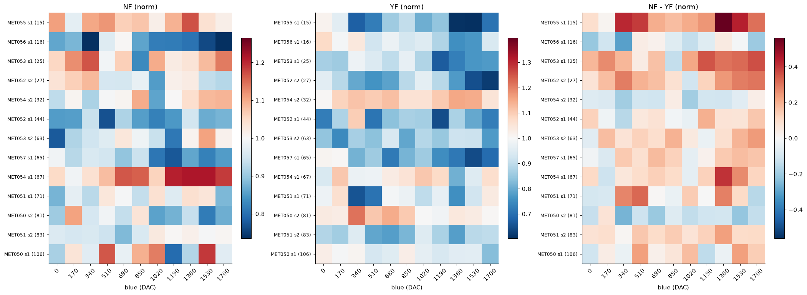
Rows = sessions sorted by PES_BY (best on top), columns = blue step. NF and
YF centered at 1 (red = above baseline), NF - YF centered at 0 (red = NF
above YF).

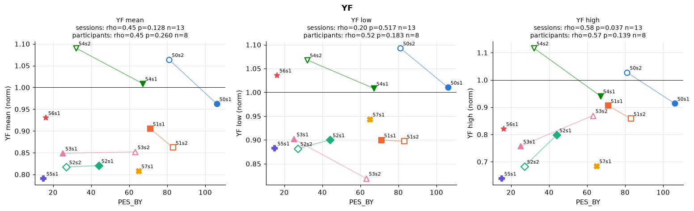
YF mean / low / high vs PES_BY. Filled = session 1, open = session 2, lines
join a participant's sessions.

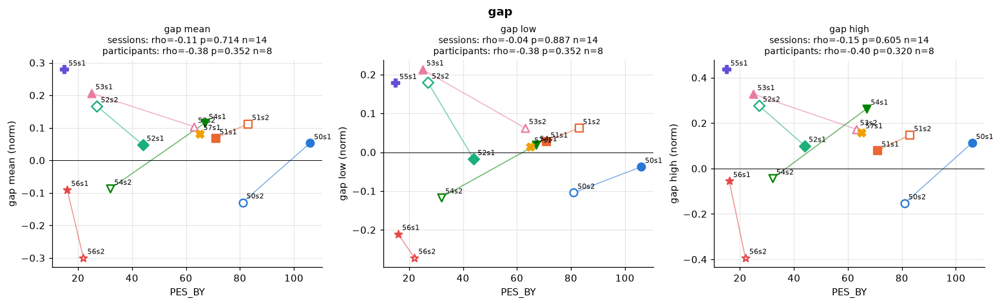

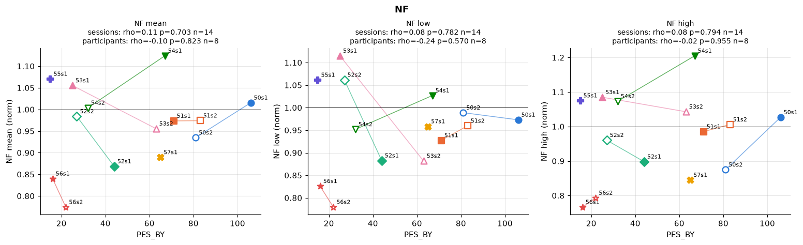

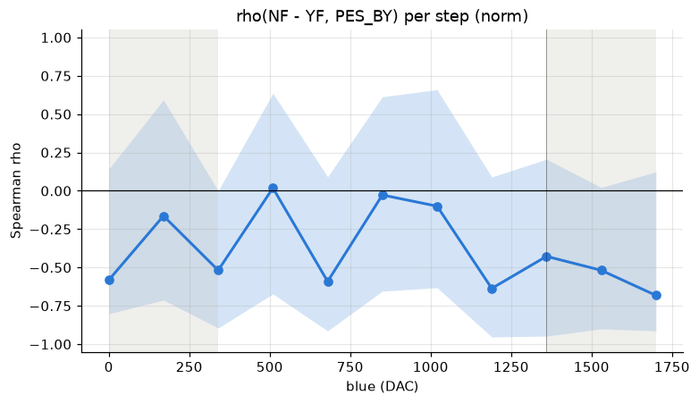
Exploratory: at each blue step, Spearman rho between NF - YF and PES_BY
across sessions. Band = participant-bootstrap 95% CI. Below 0 = smaller gap
with worse blue-yellow score.

### M2. Minimum at 1360?
- NF: no dip. Contrast 1360 - mean(0, 1700) = +0.04, 95% CI [+0.01, +0.07];
  1360 is higher than the ends.
- YF: -0.08, 95% CI [-0.15, -0.01], 99% of bootstraps below 0 (also 99%
  before MET056b; 97% before MET057, 90% before MET056). The CI excludes 0:
  a dip at 1360 under YF, uncorrected.
- Per-session minima land almost anywhere along the blue axis.
- Lead: the pooled YF curve shows two shallow dips, ~510 and ~1360. NF is
  flatter.

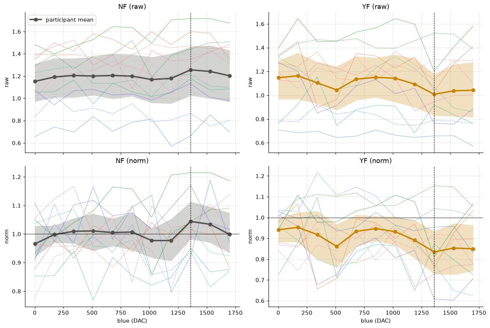
Thick line = mean of participants (sessions averaged first), band =
participant-bootstrap 95% CI, thin lines = individual sessions (color =
participant). Dashed vertical = 1360.

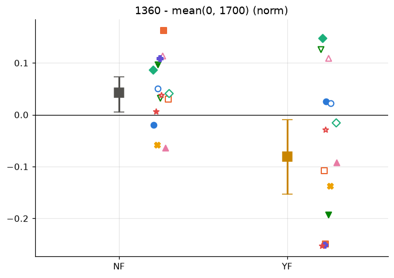
Value at 1360 minus the mean of 0 and 1700, per session (color/marker =
participant, filled = session 1, open = session 2). Square + bar =
participant-bootstrap mean and 95% CI.

### M3. Session repeatability (n = 6)

| ICC(A,1) [95% CI] | mean | low | high |
|---|---|---|---|
| NF | 0.58 | not meaningful* | 0.77 [0.12, 0.96] |
| YF | 0.71 [0.04, 0.95] | 0.83 | 0.26 |
| NF - YF | 0.48 | 0.66 | 0.38 |
| PES_BY (FM100), n = 7 | 0.71 | | |

Before MET056b (n = 5): NF mean 0.05, NF high 0.53, YF mean 0.84
[0.20, 0.98], YF low 0.80, YF high 0.58, gap 0.09 / 0.23 / -0.04, PES_BY
0.66 (n = 6).

\* Under NF, blue 0-340 is nearly the baseline stimulus, so `norm` ~1 for
everyone; there is no between-person spread to repeat.

- MET056 is the sixth pair and it moves almost every ICC, a sign of how
  small n is. Its NF is low in both sessions (high 0.77 / 0.79, the two
  lowest of all), so NF ICCs rise (high 0.53 -> 0.77, mean 0.05 -> 0.58)
  and so do the gap ICCs. Its YF high goes 0.82 -> 1.19, so YF high drops
  (0.58 -> 0.26).
- YF low (0.83) and YF mean (0.71) stay the most repeatable YF measures;
  NF high is now as repeatable. FM100 PES_BY sits in the same range (0.71).
- Per-step ICC: NF 0.69-0.76 at 850, 1360 and 1700, poor below 700. YF
  0.59-0.72 at 170, 510 and 1020, near 0 at 1360. CIs span roughly -0.9 to
  0.95.
- Lead: NF curve *shape* repeats better across sessions than YF (mean
  s1-vs-s2 rho 0.15 vs -0.10); level differences are similar (mean
  |s1 - s2| 0.107 vs 0.125).
- FM100 practice effect: participants tend to score better on session 2.
  Pairing is within session.

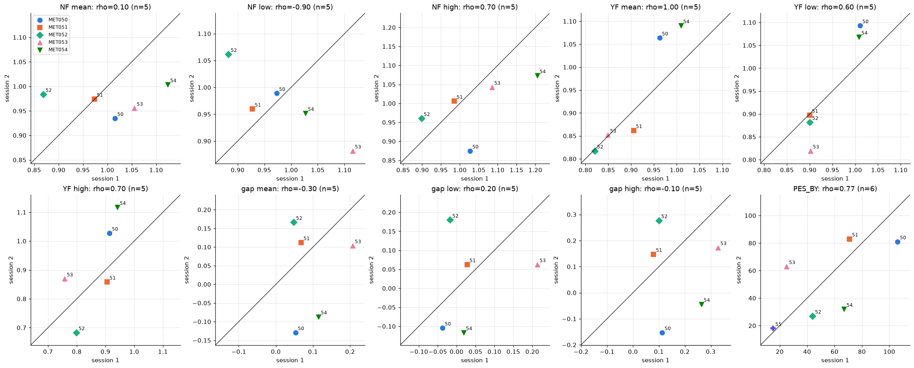
Session 1 vs session 2 for every feature and PES_BY. Identity line = perfect
repeat.

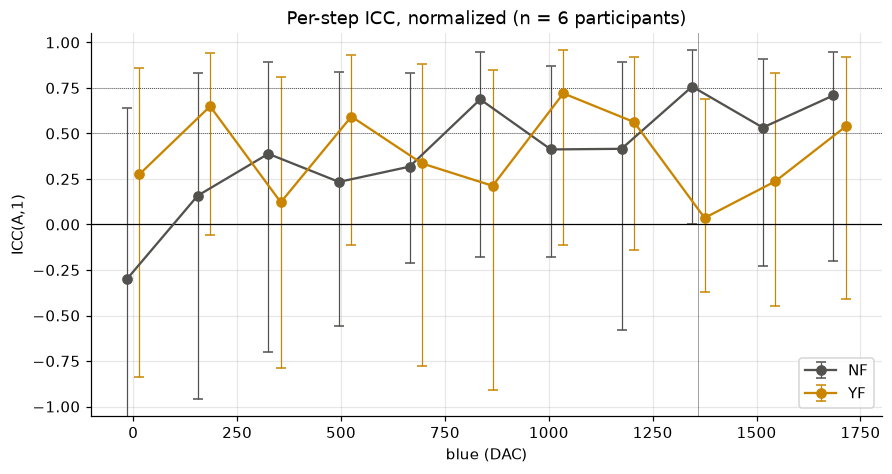
ICC(A,1) per blue step with 95% CIs. Dotted lines at 0.5 and 0.75.

### MET055 session 2 (setup error, off-grid)
Assessed in the last section of `04_brtest_fm100.ipynb`.
- The run is usable as data: interpolating it onto the common grid and
  averaging its own in-range steps give window features within ~0.04 of each
  other.
- YF repeats across MET055's sessions (mean 0.79 vs 0.76). Added as a
  seventh pair (interpolated), YF ICCs hold or rise: mean 0.71 -> 0.78, high
  0.26 -> 0.43.
- NF does not: session 2 NF sits below baseline above ~900 DAC (0.72-0.87;
  below every on-grid session from ~1300 up) and the NF - YF gap collapses
  (high 0.44 -> 0.01). Part of it is a higher NF baseline (median 1.24 vs
  0.97); raw NF at high blue is also lower. PES_BY barely moves (15 -> 18).
  Added as a pair, NF ICCs drop (high 0.77 -> 0.45).
- Decision for now: kept out of the main analyses. Its YF features can be
  used via interpolation if a larger n is needed.

### MET056 (first session on the 0-2210 grid)
- PES_BY 16 (second best). Baseline medians NF 1.38, YF 1.14, in the usual
  range (MET051-MET054: 1.2-1.5).
- NF sits below baseline at almost every step (norm 0.73-1.00) and falls
  from ~850 up; at 1360-1700 (0.80, 0.76, 0.73) it is the lowest of every
  on-grid session (others 0.81-1.21). YF dips to 0.76 at 1360-1530 and comes
  back. Result: the NF - YF gap is negative at 1700 (0.74 vs 0.94).
  Per-session minimum: NF 1700, YF 1360.
- Extended steps (norm, NF / YF): 1870 0.82 / 1.04, 2040 0.97 / 0.95,
  2210 0.82 / 1.16. YF climbs back above baseline past 1700; NF stays below.
  One session, so no pooled curve above 1700 yet.
- Lead: the two sessions recorded with 14-step runs (MET055b, MET056, one
  day apart) are the only ones with NF this far below baseline at high blue.
  Worth checking whether anything else in the setup changed with the new
  run length (stimulus order, timing, calibration) before reading this as a
  property of the participants. MET057 (below) partly follows the pattern.

### MET057 (second session on the 0-2210 grid)
- CTR, PES_BY 65 (TES 128; only MET050 and MET051 session 2 score worse
  among BRtest sessions). Baseline medians NF 1.46, YF 1.30, usual range.
- NF drifts down from ~1000 up (0.78-0.86 at 1020-1700); NF high 0.84 is the
  second lowest of the on-grid sessions after MET056 (0.77); the eleven
  11-step sessions span 0.87-1.20. YF falls further (0.65-0.72 at 1360-1700),
  so unlike MET056 the NF - YF gap stays positive (high 0.16).
  Per-session minimum: NF 1190, YF 1530.
- Extended steps (norm, NF / YF): 1870 0.81 / 0.66, 2040 0.72 / 0.66,
  2210 0.82 / 0.75. Both stay below baseline past 1700 (MET056's YF climbed
  back above 1).
- All three 14-step sessions (MET055b, MET056, MET057) now have the lowest NF
  at high blue. The setup-change check above is more pressing.

### MET056 session 2 (first repeat on the 0-2210 grid)
- PES_BY 22 (session 1: 16; TES 24 -> 56). Baseline medians NF 1.16,
  YF 0.96, both lower than session 1 (1.38, 1.14).
- NF is below baseline at every step (norm 0.70-0.84), mostly lower than
  session 1 below 1300 and similar above (high 0.79 vs 0.77). The pattern repeats a
  week later, so for MET056 it is stable. It is still confounded with the
  14-step setup: every 14-step session shows it.
- YF is the opposite of session 1: above baseline at about half the steps
  and highest at high blue (1.11-1.32 at 1360-1700; YF high 1.19, highest of all
  sessions). The NF - YF gap is negative throughout (high -0.39, lowest of
  all). Per-session minimum: NF 1020, YF 680.
- Extended steps (norm, NF / YF): 1870 0.79 / 0.96, 2040 0.90 / 0.99,
  2210 0.80 / 1.06. Close to session 1 (0.82 / 1.04, 0.97 / 0.95,
  0.82 / 1.16): the 1870-2210 steps repeat better than the low-blue YF.
- This is the first two-session pair above 1700 (one participant), so still
  no pooled curve there.

## Open questions

- Which blue step is missing in MET052 session 1 `BR_YF_2`.
- Is the YF dip structure (~510, ~1360) related to the filter's transmission
  at each blue setting? Compare with `light_meter/` measurements.
- M4: reprocess raw EEG to improve SNR (FBCCA settings, TRCA, spatial
  filters; artifact handling without ICA). Waiting on raw EEG.

## Log

- 2026-11-12: first analysis, 6 participants / 11 sessions (MET050-MET055,
  MET055 session 1 only).
- 2026-11-17: MET055 session 2 added (14 steps over 0-1700 by mistake;
  off-grid, assessed separately). Main results unchanged; FM100 PES_BY ICC
  0.50 -> 0.66 with the sixth pair. Notebook now handles 14-step sessions
  (0-2210) for MET056 on.
- 2026-11-18: MET056 session 1 added, first on the 0-2210 grid (first 11
  steps on the common grid). YF high vs PES_BY holds (+0.63, p = 0.028);
  YF mean and the NF - YF gap weaken (gap high -0.58 -> -0.35). ICCs
  unchanged (no second session yet).
- 2026-11-19: MET057 session 1 added (14 steps, 0-2210; PES_BY 65). YF high
  vs PES_BY holds over sessions (+0.58, p = 0.037), not over participants
  (+0.57, p = 0.14). YF dip at 1360 now has a CI below 0. MET057's NF is also
  below baseline at high blue: all three 14-step sessions share this.
- 2026-11-25: MET056 session 2 added (14 steps, 0-2210; PES_BY 22). NF
  below baseline again; YF above baseline at high blue. No feature vs
  PES_BY is significant any more (YF high +0.58 -> +0.36, p = 0.21 over
  sessions). Sixth ICC pair: NF ICCs rise (high 0.77), YF high drops
  (0.26); FM100 PES_BY ICC 0.71 (n = 7).
