# Blue/red linear (BRtest) findings

Living summary. Update the "Current results" section and add a line to the
log each time new participants are added. Plan and checklist:
`PLANblueredLinear.md`. Design: `docs/superpowers/specs/2026-11-12-blueredlinear-brtest-design.md`.
Notebook: `blueredLinear/notebooks/04_brtest_fm100.ipynb` (re-run all cells
after adding data). Running it also regenerates the figures below
(`docs/figures/brlinear_*.png`).

## Experiment

- Blue (0-1700 DAC, 11 steps of 170) flickers at 10 Hz against fixed red
  (1800 DAC). 3 s stimulus, 750 ms gap.
- Runs per session, in order: red baseline NF (8 trials, red vs blue 0),
  BR NF rep 1, BR NF rep 2, red baseline YF, BR YF rep 1, BR YF rep 2. Each
  BR run starts with 2 non-flickering red trials.
- YF = yellow filter that blocks blue, minimally affects red.
- Blue 1360 is the measured luminance match to red 1800.
- Two sessions about one week apart (file suffix `b` = session 2).
- Each value is an FBCCA score on a 3 s epoch (not an amplitude): chance
  level is ~0.6-0.8 (non-flicker trials), and the scale saturates.

Hypotheses:
1. Intact blue vision -> NF and YF curves differ; blue deficit -> they
   converge. Should follow the FM100 blue-yellow score (PES_BY, higher = worse).
2. NF curve has its minimum near 1360 (luminance match).

## Methods

- `norm` = score / baseline, baseline = median of the same participant x
  session x filter's 8-trial base run (NF by `base_NF`, YF by `base_YF`).
  1 = as strong as red vs nothing. Mean instead of median changes per-condition
  baselines by < 0.08 and correlations by <= ~0.15.
- The two reps are averaged per step.
- Windows on the blue axis: `mean` = all 11 steps, `low` = 0, 170, 340,
  `high` = 1360, 1530, 1700.
- Correlations: Spearman, over sessions and over participants (sessions
  averaged first). Bootstrap CIs resample participants. ICC(A,1): two-way
  random, absolute agreement, single measurement.
- MET052 session 1 `BR_YF_2` has 10 steps (which one is missing is unknown);
  only rep 1 is used for that condition.

## Current results

Data as of 2026-11-12: 6 participants (MET050-MET055, all CTR, age > 50),
11 sessions, 5 with both sessions. PES_BY range 15-106. All p-values
uncorrected; many tests were run. Treat everything as leads.

### Data quality
- The blue = 0 step falls inside its baseline's min-max in 38/43 reps, but
  sits in the lower half of the baseline trials more often than not.
- MET050 barely responds (baseline ~0.73 vs non-flicker ~0.63).
- Rep 1 vs rep 2 agreement per step is weak.

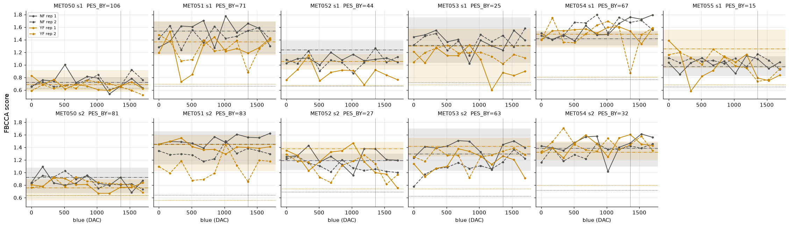
Raw FBCCA score per session (columns = participants, rows = sessions). Gray =
NF, gold = YF; solid = rep 1, dashed = rep 2. Shaded band = min-max of the
8 baseline trials, dash-dot = baseline median, dotted = non-flicker floor.

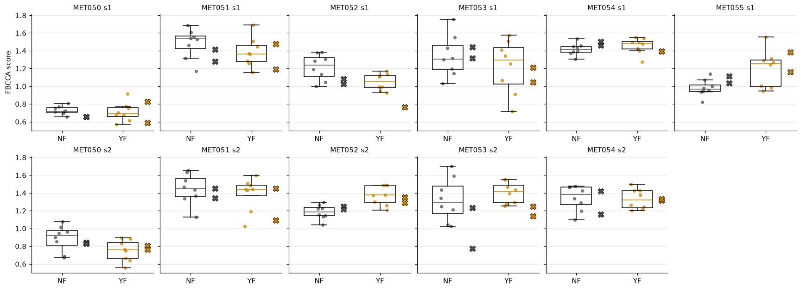
Anchor check. Box + dots = the 8 baseline trials; X = the blue = 0 step of
each rep (same stimulus).

### M1. NF vs YF against FM100 blue-yellow
- NF sits above YF at almost every step.
- The YF curve carries most of the FM100 relation: better blue-yellow ->
  YF drops further below its baseline, especially at high blue.

| Feature vs PES_BY | rho sessions (p), n = 11 | rho participants (p), n = 6 |
|---|---|---|
| YF mean | +0.59 (0.056) | +0.83 (0.042) |
| YF high | +0.58 (0.060) | +0.83 (0.042) |
| NF - YF mean | -0.55 (0.083) | |
| NF - YF high | -0.58 (0.060) | |

- Dropping MET050: YF high +0.62, gap high -0.60. The result does not rest on
  the weakest responder.
- Signs fit hypothesis 1: worse blue vision -> YF stays nearer baseline ->
  curves converge.

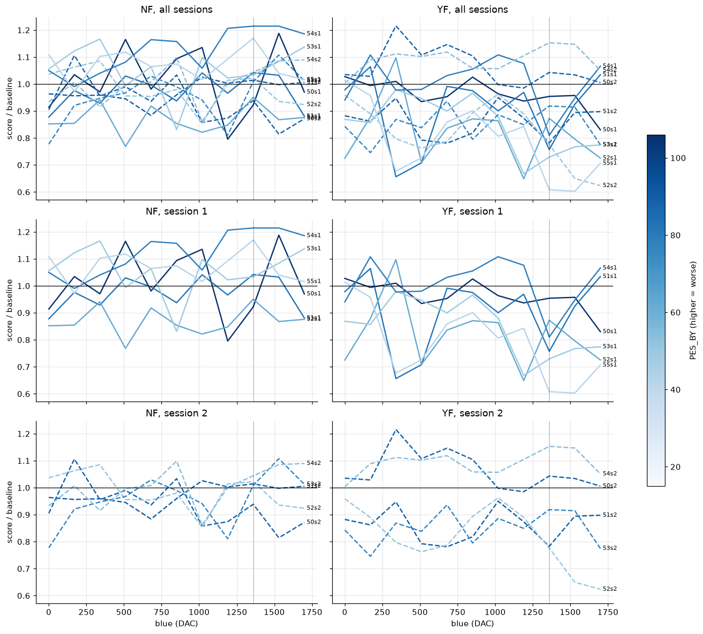
Normalized curves, one line per session, darker = worse PES_BY. Rows: all
sessions, session 1, session 2.

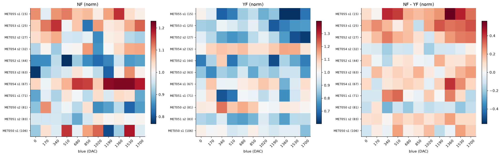
Rows = sessions sorted by PES_BY (best on top), columns = blue step. NF and
YF centered at 1 (red = above baseline), NF - YF centered at 0 (red = NF
above YF).

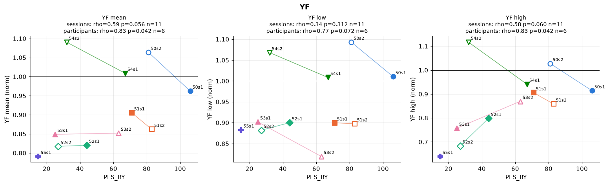
YF mean / low / high vs PES_BY. Filled = session 1, open = session 2, lines
join a participant's sessions.

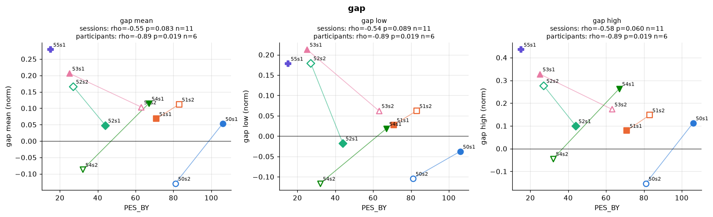

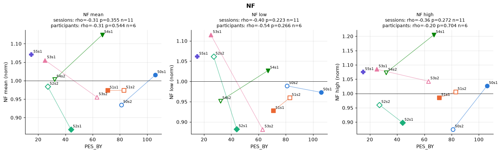

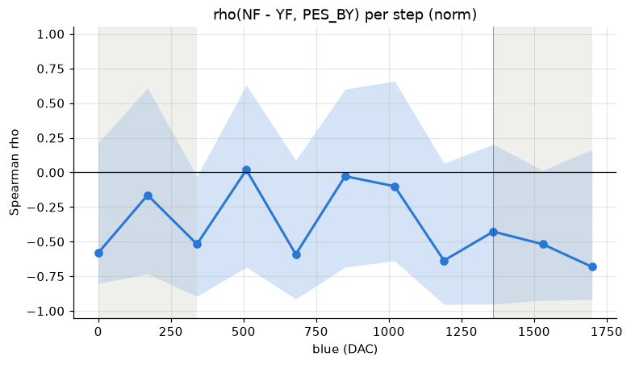
Exploratory: at each blue step, Spearman rho between NF - YF and PES_BY
across sessions. Band = participant-bootstrap 95% CI. Below 0 = smaller gap
with worse blue-yellow score.

### M2. Minimum at 1360?
- NF: no dip. Contrast 1360 - mean(0, 1700) = +0.06, 95% CI [+0.04, +0.09];
  1360 is higher than the ends.
- YF: -0.06, 95% CI [-0.16, +0.03], 90% of bootstraps below 0. Leans toward
  a dip, not conclusive.
- Per-session minima land almost anywhere along the blue axis.
- Lead: the pooled YF curve shows two shallow dips, ~510 and ~1360. NF is
  flatter.

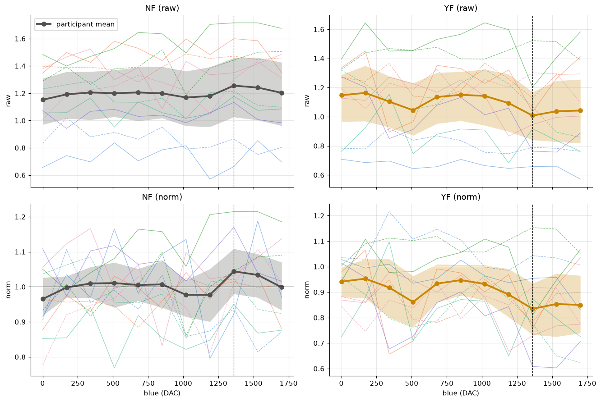
Thick line = mean of participants (sessions averaged first), band =
participant-bootstrap 95% CI, thin lines = individual sessions (color =
participant). Dashed vertical = 1360.

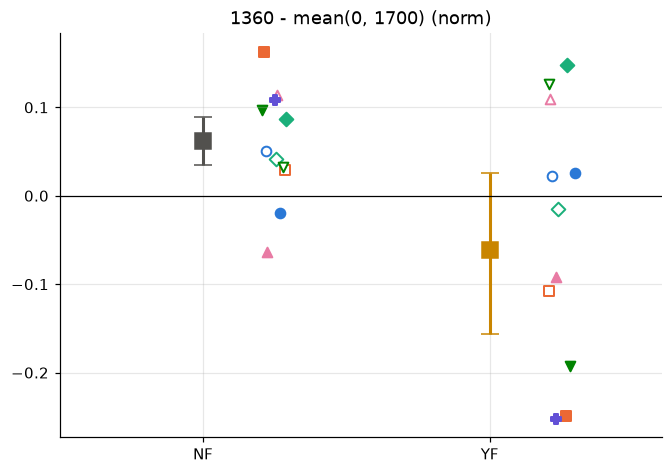
Value at 1360 minus the mean of 0 and 1700, per session (color/marker =
participant, filled = session 1, open = session 2). Square + bar =
participant-bootstrap mean and 95% CI.

### M3. Session repeatability (n = 5)

| ICC(A,1) [95% CI] | mean | low | high |
|---|---|---|---|
| NF | 0.05 | not meaningful* | 0.53 |
| YF | 0.84 [0.20, 0.98] | 0.80 | 0.58 |
| NF - YF | 0.09 | 0.23 | -0.04 |
| PES_BY (FM100) | 0.50 | | |

\* Under NF, blue 0-340 is nearly the baseline stimulus, so `norm` ~1 for
everyone; there is no between-person spread to repeat.

- YF mean is the most repeatable measure and also the one that best tracks
  PES_BY. It is more repeatable than the FM100 itself in these participants.
- The gap repeats poorly: subtracting two noisy curves adds their noise.
- Per-step ICC: YF moderate-good at most steps (0.66-0.77 at 170, 510, 1020,
  1700); NF poor below 500, ~0.6 at 850 and 1700. CIs span roughly -0.5 to
  0.9 at every step.
- Lead: NF curve *shape* repeats better across sessions than YF (mean
  s1-vs-s2 rho 0.23 vs -0.07), though level differences are similar (mean
  |s1 - s2| 0.107 vs 0.109).
- FM100 practice effect: participants tend to score better on session 2.
  Pairing is within session.

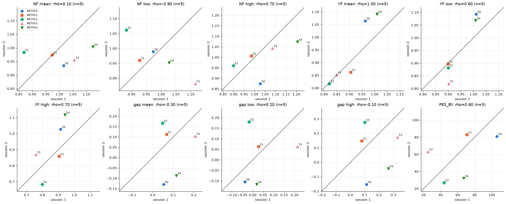
Session 1 vs session 2 for every feature and PES_BY. Identity line = perfect
repeat.

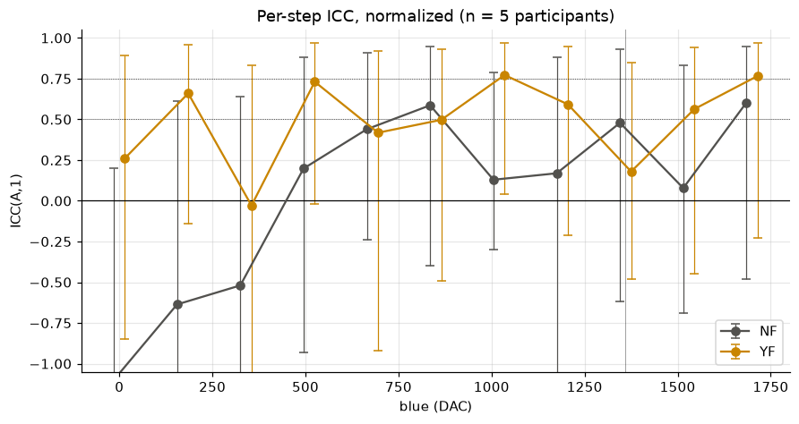
ICC(A,1) per blue step with 95% CIs. Dotted lines at 0.5 and 0.75.

## Open questions

- Which blue step is missing in MET052 session 1 `BR_YF_2`.
- Is the YF dip structure (~510, ~1360) related to the filter's transmission
  at each blue setting? Compare with `light_meter/` measurements.
- M4: reprocess raw EEG to improve SNR (FBCCA settings, TRCA, spatial
  filters; artifact handling without ICA). Waiting on raw EEG.

## Log

- 2026-11-12: first analysis, 6 participants / 11 sessions (MET050-MET055,
  MET055 session 1 only).
